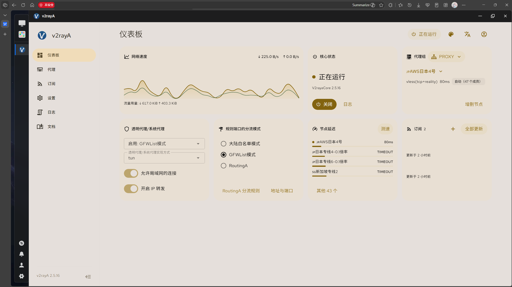

# v2rayA for 飞牛 fnOS

把 [v2rayA](https://github.com/v2rayA/v2rayA) 打包成飞牛 fnOS 原生 `.fpk` 应用。
从桌面点击图标即可打开，复用系统统一网关与登录态，无需开放额外 TCP 端口。



## 特性

- **统一网关接入** — 走飞牛登录态，不额外暴露监听端口
- **TUN / 透明代理** — 以 root 运行，支持 `tun`、`tproxy`、`redirect` 三种方式
- **离线可用** — 内置 geoip/geosite 规则库，首次启动不联网下载
- **生命周期完整** — 安装/升级/卸载/配置向导，数据可保留

## 安装

1. 下载 `dist/v2raya_<version>_x86.fpk`
2. 飞牛 **应用中心 → 手动安装**，选择该文件
3. 首次打开时在页面内创建管理员账户

支持 x86_64，要求 fnOS ≥ 1.1.3100。

### 从旧版本升级

旧版（`2.5.16-1` ~ `2.5.16-3`，lite 模式）升级后，需在**设置 → 透明代理实现方式**
重新选择 `tun` / `tproxy` / `redirect` 并保存一次。旧值 `system_proxy` 在 root 模式下无效。

## 使用

### 局域网访问

让局域网内其他设备使用代理，请用 v2rayA 自身的设置：**设置 → 允许局域网的连接**
（`portSharing`），它会把 SOCKS/HTTP 入站从 `127.0.0.1` 放宽到 `0.0.0.0`，
之后客户端指向 `NAS地址:20170`（SOCKS5）或 `:20171`（HTTP）即可。

把本机当作**透明网关**属于系统层面的网络配置（需要额外的转发与 NAT 规则），
不属于本包的适配范围。

### DNS over HTTPS

v2rayA 没有独立的 DoH 开关，DoH 作为 DNS 上游 URL 配置：

- 位置：**订阅 → 配置 → 节点 DNS**
- 填法：完整 URL，例如 `https://1.1.1.1/dns-query`
- 前提：`dnsMode` 为 `hijack`（本包默认开启）

## 从源码构建

仓库不包含第三方二进制与规则库（约 108 MB），构建前先拉取：

```bash
bash scripts/fetch-payload.sh   # 下载 v2raya / v2raya_core / geoip / geosite
bash build.sh                   # 产出 dist/*.fpk
```

## 测试

```bash
bash tests/run-all.sh    # 全部套件
```

| 套件 | 覆盖内容 |
| --- | --- |
| `lint.sh` | 静态检查：JSON、manifest 字段、脚本语法、图标、路径 |
| `fpk-structure.sh` | 产物结构、权限位、内嵌文件完整性 |
| `smoke.sh` | 模拟安装：start / stop / status 与退出码契约 |
| `gateway-sim.sh` | 网关前缀保留链路 |
| `reinstall-keepdata.sh` | 保留数据重装（悬空软链接回归） |
| `core-start.sh` | 核心启动、端口绑定、TUN 权限、无自造功能校验 |

## 项目结构

```
├── app/
│   ├── server/          # v2raya + v2raya_core（构建时下载）
│   ├── assets/          # geoip / geosite（构建时下载）
│   ├── ui/config        # 桌面入口（统一网关）
│   └── www/             # 兜底说明页
├── cmd/                 # 生命周期脚本
├── config/              # 权限与资源声明
├── wizard/              # 安装 / 设置 / 卸载向导
├── scripts/             # 依赖拉取
├── tests/               # 验收套件
├── docs/                # 设计文档
└── build.sh             # 打包入口
```

## 文档

- [设计决策与实测记录](docs/DECISIONS.md) — 22 条取舍及证据
- [集成契约](docs/INTEGRATION-CONTRACT.md) — 接口与验收标准

## 许可

适配代码采用 [MIT](LICENSE)。构建产物内含 GPL-3.0 的 v2rayA 二进制，
整体分发时受 GPL-3.0 约束，详见 [LICENSE-note.md](LICENSE-note.md)。
